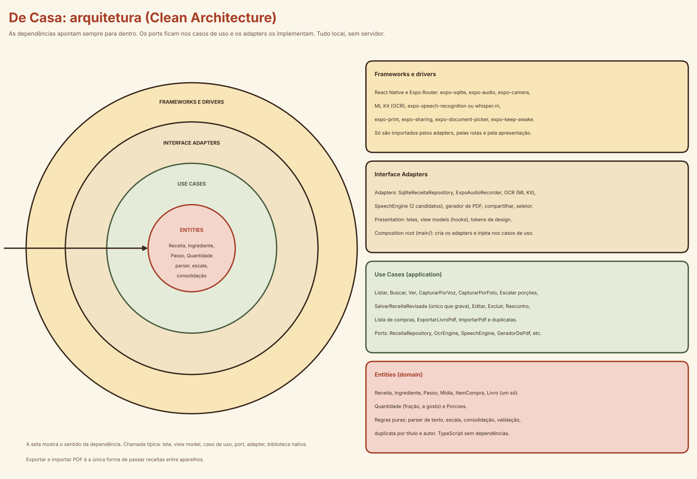

# De Casa: documento de arquitetura

Versão 1.2, 24/11/2026. Complementa `requisitos.md`. Escopo completo, sem fase de MVP, sem nuvem e sem livro compartilhado. Organizada em Clean Architecture.



## 1. Visão geral

O De Casa é um app React Native (Expo, em dev build) **offline-first**, organizado em **Clean Architecture**. Tudo o que o usuário faz acontece contra um banco SQLite no próprio aparelho, que é a única fonte de dados. Não há servidor, conta nem sincronização. Passar receitas para outra pessoa é por PDF: uma pessoa exporta, envia pela folha de compartilhamento do sistema e a outra importa.

Princípios:

1. **Local primeiro.** Nenhuma tela depende de internet.
2. **Sem IA paga.** OCR, transcrição e parser rodam no aparelho ou por regras.
3. **Revisão humana sempre.** OCR, transcrição e importação erram. Nada vira receita sem passar pela tela de revisão, e só um caso de uso grava receita (RN02).
4. **Regra de dependência.** Cada camada só importa de camadas mais internas. O domínio não conhece casos de uso, telas nem bibliotecas.
5. **Bibliotecas nativas atrás de ports.** Para trocar uma biblioteca (ex.: transcrição) sem mexer em regras nem em telas.
6. **Domínio e casos de uso testáveis sem aparelho.**

### 1.1 Por que essa arquitetura

Os motivos vêm das restrições do projeto. É raciocínio de projeto, nada disso foi medido.

- **As bibliotecas centrais ainda não foram testadas.** Transcrição, OCR e extração de texto de PDF são hipóteses (spikes S1, S2 e S4). Com ports, trocar uma biblioteca é trocar um adapter, e o resto do app não muda. Sem isso, um spike que falhe pode obrigar a mexer em telas e regras.
- **Módulos nativos não rodam em teste comum.** Câmera, áudio, fala e OCR exigem dev build e aparelho. Com as regras no domínio e nos casos de uso, parser, escala de porções, lista de compras, exportar e importar PDF e a regra RN02 rodam em testes automatizados no computador, com fakes no lugar dos ports (RNF12).
- **As regras ficam em um lugar só.** RN01 a RN05 e os critérios de aceite de parser, escala e duplicatas não se espalham pelas telas.
- **A decisão de nuvem fica reversível.** O Supabase acabou de ser retirado. Se um dia voltar, entra como outra implementação de `ReceitaRepository` e novos casos de uso. A sincronização em si seria trabalho novo, mas o domínio não muda.
- **Cada camada pode ser explicada e avaliada separadamente**, o que ajuda na apresentação da matéria.

Custos:

- Mais arquivos e mais código de ligação (mapear linha do banco, entidade e modelo de tela).
- Para um app deste tamanho, parte disso pode ser exagero. Para conter: casos de uso finos, sem DTOs duplicados quando a entidade já serve, e um caso de uso só quando há regra ou orquestração (decisões D8 a D10).
- Exige disciplina nas importações. A regra de dependência só vale se for checada (ver seção 2).

## 2. Camadas e componentes

As dependências apontam sempre para dentro: Frameworks e drivers, Interface Adapters, Use Cases, Entities.

| Camada | Pasta | O que contém | Pode importar de |
|---|---|---|---|
| Entities | `domain/` | Receita, Ingrediente, Passo, Quantidade, ItemCompra e as regras puras: parser de texto, escala de porções, consolidação da lista | Nada (só TypeScript) |
| Use Cases | `application/` | Casos de uso, os ports (interfaces) e o codec do apêndice de dados do PDF | `domain/` |
| Interface Adapters | `adapters/` e `presentation/` | Adapters que implementam os ports (SQLite, áudio, OCR, fala, PDF) e a apresentação (telas, view models em hooks) | `application/` e `domain/` |
| Frameworks e drivers | (código de terceiros) | React Native, Expo Router, `expo-sqlite`, `expo-audio`, `expo-camera`, ML Kit, fala, `expo-print`, `expo-sharing`, `expo-document-picker`, `expo-keep-awake` | Só é importado por `adapters/`, pelas rotas e pela apresentação |

O **composition root** (`main/`) é o único lugar que conhece todas as camadas: ele cria os adapters, injeta nos casos de uso e entrega o resultado à interface (por contexto do React). A injeção é manual, sem biblioteca de DI (D10).

**Como garantir a regra de dependência:** uma regra de lint de importações (por exemplo `eslint-plugin-boundaries`) que proíba `domain/` de importar de fora e `application/` de importar de `adapters/` ou `presentation/`. Não testei essa configuração.

### 2.1 Entities (`domain/`)

- **Entidades:** `Receita` (com `Ingrediente` e `Passo`), `Midia`, `ItemCompra`, `Livro` (uma só instância, RN01).
- **Objetos de valor:** `Quantidade` (inteiro, decimal, fração, fração unicode e "a gosto", RN03) e `Porcoes`.
- **Regras puras:** `textoParaReceita` (parser, RF07), `escalar` (RF12), `consolidarItens` (RN04), validação de receita (título, 1 ingrediente e 1 passo, RF03), detecção de duplicata por título e autor (RF16).

### 2.2 Casos de uso e ports (`application/`)

Cada caso de uso tem uma responsabilidade e recebe os ports que precisa pelo construtor.

| Caso de uso | Requisitos | Ports que usa |
|---|---|---|
| `ListarReceitas`, `BuscarReceitas` | RF01, RF02 | `ReceitaRepository` |
| `VerReceita` | RF09 | `ReceitaRepository` |
| `CapturarPorVoz` (gravar, transcrever, converter em rascunho) | RF04, RF06, RF07 | `AudioRecorder`, `SpeechEngine`, `MidiaStorage`, `PermissoesDoSistema` |
| `CapturarPorFoto` (foto, OCR, converter em rascunho) | RF05, RF07 | `OcrEngine`, `MidiaStorage`, `PermissoesDoSistema` |
| `GerenciarRascunho` (salvar, recuperar, descartar) | RF03, RF08, RNF08 | `RascunhoRepository` |
| `SalvarReceitaRevisada` (**único** que grava receita) | RF03, RF08, RN02 | `ReceitaRepository`, `MidiaStorage`, `IdGenerator`, `Relogio` |
| `EditarReceita`, `ExcluirReceita` | RF10 | `ReceitaRepository`, `MidiaStorage` |
| `EscalarPorcoes` | RF12 | nenhum (só domínio) |
| `GerarListaDeCompras` (adicionar, marcar, limpar, exportar como texto) | RF13 | `ListaComprasRepository`, `Compartilhador` |
| `ExportarLivroPdf` | RF14 | `ReceitaRepository`, `GeradorDePdf`, `Compartilhador` |
| `ImportarPdf` e `ConfirmarImportacao` (inclui duplicatas) | RF15, RF16 | `SeletorDeArquivo`, `PdfTextExtractor`, `OcrEngine`, `ReceitaRepository` |

O modo cozinha (RF11) não tem caso de uso próprio: usa `VerReceita` e `EscalarPorcoes`, e manter a tela acesa é da apresentação (`expo-keep-awake`). Os casos de captura devolvem um rascunho e **nunca gravam** receita. Assim a regra RN02 vale pela estrutura, não por disciplina.

Os ports ficam em `application/ports/`. Os esboços abaixo são ilustrativos.

```ts
// Repositórios
interface ReceitaRepository {
  listar(): Promise<Receita[]>;
  buscar(termo: string): Promise<Receita[]>;
  obter(id: string): Promise<Receita | null>;
  salvar(receita: Receita): Promise<void>; // transacional (RNF08)
  excluir(id: string): Promise<void>;
}
interface RascunhoRepository { salvar(r: Rascunho): Promise<void>; recuperar(): Promise<Rascunho | null>; descartar(): Promise<void>; }
interface ListaComprasRepository { /* itens, marcar, limpar */ }

// Plataforma
interface OcrEngine {
  recognize(imageUri: string): Promise<{ text: string; confidence?: number }>;
}
interface SpeechEngine {
  isAvailable(locale: 'pt-BR'): Promise<boolean>;
  transcribe(audioUri: string, opts: { onProgress?: (p: number) => void; signal?: AbortSignal }): Promise<string>;
}
interface PdfTextExtractor {
  extract(pdfUri: string): Promise<{ pages: string[]; hasText: boolean }>;
}
interface AudioRecorder {
  start(): Promise<void>;
  stop(): Promise<{ uri: string; durationSec: number }>;
}
interface GeradorDePdf { gerar(livro: LivroParaExportar, opts: { incluirFotos: boolean }): Promise<string>; } // devolve a uri do arquivo
interface Compartilhador { compartilharArquivo(uri: string): Promise<void>; compartilharTexto(texto: string): Promise<void>; }
interface SeletorDeArquivo { escolherPdf(): Promise<string | null>; }
interface MidiaStorage { /* salvar, abrir e apagar arquivos de áudio e foto */ }
interface PermissoesDoSistema { solicitar(tipo: 'microfone' | 'camera' | 'fala'): Promise<'concedida' | 'negada'>; }
interface IdGenerator { novo(): string; }
interface Relogio { agora(): Date; }
```

`SpeechEngine` tem duas implementações candidatas (seção 3). A escolha final depende do spike S1.

Exemplo de caso de uso (esboço): ele orquestra ports e regras puras e não conhece nenhuma biblioteca.

```ts
class CapturarPorVoz {
  constructor(private fala: SpeechEngine) {}
  async transcreverParaRascunho(audioUri: string, opts: OpcoesDeTranscricao): Promise<Rascunho> {
    const texto = await this.fala.transcribe(audioUri, opts);
    return textoParaReceita(texto); // regra pura do domínio
  }
}
```

O codec do apêndice de dados do PDF (seção 5.4) fica em `application/intercambio/`. É TypeScript puro e os casos de exportar e importar dependem dele.

### 2.3 Interface Adapters (`adapters/` e `presentation/`)

- **`adapters/persistence/`:** conexão e migrações do SQLite, `SqliteReceitaRepository` e os demais repositórios, mapeadores de linha para entidade.
- **`adapters/native/`:** `ExpoAudioRecorder`, `MlKitOcrEngine` (ou `ExpoTextExtractorOcr`), `ExpoSpeechRecognitionEngine` e `WhisperEngine` (a escolha sai do spike S1), `ExpoPdfTextExtractor`, `ExpoSharingCompartilhador`, `ExpoDocumentPickerSeletor`, `ExpoPermissoes`, armazenamento de mídia em arquivos.
- **`adapters/pdf/`:** `ExpoPrintGeradorDePdf`, com o modelo HTML (capa, uma receita por página).
- **`presentation/`:** telas e componentes por funcionalidade, mais os view models (hooks) que chamam os casos de uso. As rotas do Expo Router (`src/app/`) são finas e só montam as telas.

## 3. Stack e bibliotecas

**Importante:** as bibliotecas abaixo foram avaliadas **só por leitura de páginas e descrições**, sem teste prático. Nenhuma está validada para sotaque, ruído de cozinha, letra manuscrita ou PDFs reais. Todas pertencem à camada Frameworks e drivers e só são importadas por adapters (seção 2).

| Necessidade | Escolha | O que li | Status |
|---|---|---|---|
| App | React Native + Expo, dev build, Expo Router, TypeScript | Decisão do projeto | Decidido |
| Banco local | `expo-sqlite` | Decisão do projeto | Decidido |
| Áudio | `expo-audio` | Decisão do projeto | Não testado |
| Foto | `expo-camera` e galeria | Decisão do projeto | Não testado |
| OCR | `@react-native-ml-kit/text-recognition` (ML Kit) ou `expo-text-extractor` (ML Kit no Android, Apple Vision no iOS) | Ambas fazem OCR no aparelho. Nas páginas lidas não achei dados de precisão em letra manuscrita. O ML Kit de tinta digital (Digital Ink) é outra coisa: reconhece traços feitos na tela, não fotos. | Candidatas; precisão em manuscrito não verificada (spike S2) |
| Transcrição, opção A | `expo-speech-recognition` | Tem a opção `requiresOnDeviceRecognition`, com padrão `false` (ou seja, pode enviar áudio pela rede se não for ligada). Na documentação indexada, no Android é preciso checar `getSupportedLocales()` para garantir que o modelo de fala está instalado. Há exemplo de transcrição de arquivo de áudio. Um relato em fórum da Apple diz que, no iOS, o reconhecimento no aparelho só funciona offline com o idioma de ditado instalado. | Candidata; não testada (spike S1) |
| Transcrição, opção B | `whisper.rn` (binding do whisper.cpp) | Usa modelos no formato GGML. Documentação não oficial recomenda `small` ou `medium` para uso geral e `tiny` ou `base` para tempo real. Um app de terceiros descreve o modelo `tiny` com cerca de 75 MB; modelos maiores são bem maiores (tamanhos não verificados). | Candidata; não testada (spike S1) |
| Extração de texto de PDF | `expo-pdf-text-extract` v1.1.0 (PDFKit no iOS, PDFBox no Android) | Só PDFs digitais; não lê PDF escaneado; exige dev build. Tem poucos downloads (cerca de 3,2 mil), então baixa maturidade. Alternativa: `@dariyd/react-native-text-recognition`, que diz aceitar PDFs com Vision (iOS) e ML Kit (Android). | Candidata; não testada (spike S4) |
| Gerar PDF | `expo-print` (HTML para PDF) + `expo-sharing` | Decisão do projeto | Não testado |
| Escolher arquivo | `expo-document-picker` | Decisão do projeto | Não testado |
| Tela acesa | `expo-keep-awake` | Decisão do projeto | Não testado |

### 3.1 Armazenamento de áudio no aparelho

Estimativa (cálculo, não medição): a 64 kbps mono, 1 minuto de áudio ocupa cerca de 480 KB. Com 200 receitas de 3 minutos, seriam cerca de 290 MB só de áudio. Isso precisa ser confirmado com gravações reais (spike S5).

## 4. Modelo de dados

O banco é o SQLite do aparelho. Identificadores são UUIDs gerados no aparelho, para que receitas importadas de outro aparelho não colidam com as locais. As tabelas são detalhe dos adapters de persistência: as entidades do domínio não conhecem o SQLite, e os mapeadores convertem linha em entidade.

| Tabela | Campos principais |
|---|---|
| `livro` (uma linha só) | `id`, `nome` (padrão "Livro da Família"), `criado_em` |
| `receita` | `id`, `titulo`, `autor_nome` ("quem ensinou"), `rendimento_porcoes`, `ponto_obs`, `quando_faz`, `origem` (texto, voz, foto, pdf), `criado_em`, `atualizado_em` |
| `ingrediente` | `id`, `receita_id`, `ordem`, `quantidade_num` (nulo se "a gosto"), `quantidade_texto`, `unidade`, `nome`, `observacao` |
| `passo` | `id`, `receita_id`, `ordem`, `texto` |
| `passo_ingrediente` (opcional) | `passo_id`, `ingrediente_id` (liga ingredientes a passos, para os chips do modo cozinha) |
| `midia` | `id`, `receita_id`, `tipo` (audio ou foto), `caminho_local`, `duracao_s`, `tamanho_bytes`, `transcricao_texto`, `criado_em` |
| `lista_compras` / `item_compra` | `id`, `nome`, `quantidade_num`, `unidade`, `comprado`, `receita_origem_id` |
| `rascunho` | `id`, `payload_json`, `atualizado_em` (RF03 e RF08) |

Regras de integridade: ingredientes e passos são apagados junto da receita (a exclusão remove também os arquivos de mídia); a ordem de ingredientes e passos é explícita (`ordem`).

## 5. Fluxos principais

### 5.1 Cadastrar por voz (RF04, RF06, RF07, RF08)

1. Na tela Nova receita (aba Voz), o view model chama `CapturarPorVoz`, que pede a permissão (`PermissoesDoSistema`) e grava (`AudioRecorder`).
2. O arquivo é guardado pelo `MidiaStorage` e vira uma `midia` do rascunho.
3. Se houver transcrição disponível, o caso de uso chama `SpeechEngine.transcribe`, com progresso e cancelamento.
4. O texto passa pelo parser do domínio (`textoParaReceita`), que propõe ingredientes e passos e devolve um rascunho. Nada é gravado em receita ainda.
5. A tela Revisar mostra o rascunho, o usuário corrige, e `GerenciarRascunho` o guarda enquanto isso.
6. Ao confirmar, `SalvarReceitaRevisada` valida (título, 1 ingrediente e 1 passo) e grava receita, ingredientes, passos e mídia numa transação, pelo `ReceitaRepository`.

### 5.2 Cadastrar por foto (RF05, RF07, RF08)

Igual ao fluxo de voz, com `CapturarPorFoto` e `OcrEngine.recognize` no lugar das etapas 1 a 3. A foto fica na revisão, ao lado do texto extraído.

### 5.3 Exportar PDF (RF14)

1. Usuário escolhe receitas e se as fotos entram.
2. O caso de uso `ExportarLivroPdf` lê as receitas e o codec gera o apêndice. O port `GeradorDePdf` (adapter com `expo-print`) monta o HTML (capa, uma receita por página, texto selecionável) e gera o arquivo.
3. O PDF inclui, no fim, um apêndice "Dados para importação" (hipótese, ver 5.4 e spike S3).
4. O arquivo é entregue pelo port `Compartilhador` (adapter com `expo-sharing`), que abre a folha de compartilhamento do sistema.

### 5.4 Importar PDF (RF15, RF16)

1. Usuário escolhe o arquivo, pelo port `SeletorDeArquivo` (adapter com `expo-document-picker`).
2. `PdfTextExtractor.extract` lê o texto. Se `hasText` for falso, o PDF é tratado como escaneado: as páginas viram imagens e passam pelo OCR. Como rasterizar as páginas ainda não está definido (spike S4).
3. O caso de uso `ImportarPdf` procura o marcador do apêndice de dados do De Casa:
   - **Encontrado e válido:** recupera as receitas estruturadas, sem parser.
   - **Não encontrado ou inválido:** o texto vai para o parser, em modo "melhor esforço".
4. Duplicatas (mesmo título e autor) são sinalizadas (RF16).
5. O usuário revisa e confirma antes de qualquer gravação.

**Hipótese do apêndice de dados (a validar no spike S3):** o JSON das receitas é convertido em texto (base64), dividido em linhas numeradas com checksum, por exemplo `DC1|003/012|<dados>|<crc>`. A importação reconstrói as linhas, valida os checksums e ignora o que estiver quebrado. Escolhi texto porque a extração de PDF digital lê texto, e o apêndice sobrevive a imprimir e escanear só se houver OCR (nesse caso, cai no parser). Anexar um arquivo dentro do PDF seria mais limpo, mas não avaliei bibliotecas que façam isso nem como ler o anexo de volta no React Native.

### 5.5 Passar receitas para outra pessoa (RF14, RF15)

Não há servidor. A pessoa A exporta o PDF (5.3) e envia pela folha de compartilhamento do sistema (WhatsApp, e-mail, AirDrop etc.). A pessoa B importa o arquivo (5.4), revisa e confirma. No desenho atual o PDF leva o texto das receitas, não o áudio original.

## 6. Decisões de arquitetura

| # | Decisão | Motivo | Alternativa descartada |
|---|---|---|---|
| D1 | SQLite local como única fonte de dados | Atende RNF01, sem custo e sem conta | Nuvem como fonte da verdade (quebra o uso offline) |
| D2 | Transcrição atrás do port `SpeechEngine`, escolha após spike | As duas opções não foram testadas com o público real | Fixar uma biblioteca agora |
| D3 | Parser por regras, determinístico, no domínio | Sem custo, testável, sem IA paga | Parser com modelo de linguagem (viola RNF02) |
| D4 | PDF com apêndice de dados estruturados em texto | Permite importação confiável do PDF do próprio app | Importar sempre por parser (menos confiável) |
| D5 | Sem servidor, conta ou sincronização; compartilhar é por PDF | Menos custo, risco e escopo; atende RNF01 e RNF02 | Livro compartilhado com Supabase (conta, sincronização e RLS), retirado em 24/11/2026 |
| D6 | Identificadores UUID gerados no aparelho | Receitas importadas de outro aparelho não colidem com as locais | IDs sequenciais do banco |
| D7 | Telas organizadas por funcionalidade dentro de `presentation/` | Facilita trabalhar por requisito | Organização só por tipo de arquivo |
| D8 | Clean Architecture (Entities, Use Cases, Interface Adapters, Frameworks e drivers) | Ver a seção 1.1: bibliotecas não testadas, teste sem aparelho, regras em um lugar | Camadas simples com serviços (versão 1.1 deste documento); regra de negócio dentro das telas (rápido, mas não testável sem aparelho) |
| D9 | Casos de uso finos, sem DTOs duplicados quando a entidade já serve | Conter o código de ligação e o custo da arquitetura | Um DTO por camada para tudo |
| D10 | Injeção de dependência manual no composition root | Simples e suficiente para o tamanho do app | Biblioteca de DI (não avaliada) |

## 7. Estrutura de pastas sugerida

```
src/
  app/                      # rotas do Expo Router (finas, só montam telas)
  domain/                   # Entities: TypeScript puro, sem dependências
    receita/                # Receita, Ingrediente, Passo, Quantidade, validação
    compras/                # ItemCompra, consolidarItens
    parser/                 # textoParaReceita
    porcoes/                # escalar
  application/              # Use Cases
    usecases/               # um arquivo por caso de uso
    ports/                  # repositórios e interfaces de plataforma
    intercambio/            # codec do apêndice de dados do PDF
  adapters/                 # Interface Adapters: implementam os ports
    persistence/            # SQLite: conexão, migrações, repositórios, mapeadores
    native/                 # áudio, OCR, fala, PDF (texto), compartilhar, seletor, permissões, mídia
    pdf/                    # gerador de PDF e modelo HTML
  presentation/             # Interface Adapters: telas e view models
    livro/                  # lista, busca, ver receita
    receita/                # cadastro, revisão, edição
    captura/                # gravação, foto
    cozinha/                # modo cozinha
    compras/                # lista de compras
    pdf/                    # exportar e importar
    ui/                     # tokens de design, componentes, acessibilidade
  main/                     # composition root: cria adapters e injeta nos casos de uso
```

## 8. Segurança e privacidade

- Tudo fica no aparelho: o app não envia dados do usuário a nenhum servidor (RN05, RNF03). Áudio e foto só saem quando o usuário exporta ou compartilha um arquivo.
- Transcrição: ligar o reconhecimento no aparelho (`requiresOnDeviceRecognition: true`, no caso da opção A) e checar a disponibilidade do idioma antes de usar; sem isso, a biblioteca pode enviar áudio pela rede.
- PDF importado é dado não confiável (RNF09): validar formato, tamanho e checksum do apêndice, nunca interpretar o conteúdo como código e nunca gravar sem confirmação do usuário.
- Dados de familiares são dados pessoais; ao exportar PDF com fotos, o usuário escolhe o que sai (RF14). Vale revisar consentimento e descarte conforme a LGPD (isto não é parecer jurídico).

## 9. Testes

Cada camada tem seu tipo de teste. O executor pode ser, por exemplo, o Jest (o Expo suporta); não está definido.

- **Domínio (unitário, no computador, RNF12):** parser (com receitas reais em português), escala de porções (frações), consolidação da lista de compras, validação de receita e detecção de duplicata.
- **Casos de uso (com fakes dos ports):** `SalvarReceitaRevisada` (valida e respeita RN02), `ImportarPdf` com extrator de texto falso, `ExportarLivroPdf` com gerador falso, e o codec do apêndice com teste de ida e volta.
- **Adapters (integração):** repositórios SQLite com migrações; ida e volta exportar PDF e importar PDF.
- **Em aparelho real:** gravação, transcrição, OCR, PDF, modo cozinha (tela acesa), modo avião.
- **Usabilidade:** teste com pelo menos 3 pessoas com mais de 60 anos (RNF06).

## 10. Ordem sugerida de construção

Como tudo entra agora, esta é só uma ordem por dependência técnica, não uma priorização.

1. Base: projeto Expo em dev build, tokens de design, domínio (entidades, escala, parser), ports e casos de uso com fakes e testes, SQLite com migrações e repositórios, composition root.
2. Livro, cadastro por texto, ver, editar, excluir e busca (RF01 a RF03, RF09, RF10).
3. Áudio: gravar e tocar (RF04).
4. Foto, OCR, parser e tela de revisão (RF05, RF07, RF08).
5. Modo cozinha, escala de porções e lista de compras (RF11 a RF13).
6. Exportar PDF (RF14).
7. Importar PDF e duplicatas (RF15, RF16).
8. Transcrição automática, depois do spike S1 (RF06).

## 11. Spikes e riscos

Cada spike tem um critério de saída. Enquanto não forem feitos, as bibliotecas da seção 3 são hipóteses. Os spikes S1, S2 e S4 trocam adapters: o resultado não deve exigir mudança no domínio nem nos casos de uso.

| Spike | O que fazer | Critério de saída |
|---|---|---|
| S1 Transcrição | Gravar pelo menos 5 pessoas (incluindo 1 idosa) contando uma receita, com barulho de cozinha, e comparar as duas opções | Escolher o `SpeechEngine`. Se nenhuma for aceitável, RF06 não pode ser cumprido como escrito e precisa ser renegociado (a revisão manual continua). |
| S2 OCR manuscrito | Fotografar cerca de 10 páginas de cadernos reais e medir o quanto da revisão manual é necessário | Decidir a biblioteca de OCR e ajustar as expectativas da tela de revisão |
| S3 PDF com dados | Gerar o PDF com apêndice, extrair o texto de volta e recuperar as receitas, inclusive em PDF impresso e escaneado | Confirmar ou trocar a técnica de D4 |
| S4 PDF de terceiros | Testar a extração em cerca de 5 PDFs de receitas diferentes e em 1 escaneado | Definir a biblioteca de extração e o texto de aviso "melhor esforço" |
| S5 Armazenamento | Medir o tamanho real de áudios e fotos e o espaço usado no aparelho | Confirmar a estimativa da seção 3.1 e ajustar o formato do áudio e o aviso de espaço (RNF10) |

## 12. Fontes

Lidas apenas como páginas e descrições, sem teste prático:

- `expo-speech-recognition`: https://github.com/jamsch/expo-speech-recognition
- Reconhecimento no aparelho no iOS (fórum da Apple): https://developer.apple.com/forums/thread/731230
- `whisper.rn`: https://github.com/mybigday/whisper.rn
- Modelos do `whisper.rn` (documentação não oficial): https://mintlify.com/mybigday/whisper.rn/core-concepts/models
- Modelo `tiny` em app de terceiros: https://www.mintlify.com/alichherawalla/off-grid-mobile-ai/features/voice-transcription
- `expo-pdf-text-extract`: https://cdn.jsdelivr.net/npm/expo-pdf-text-extract@1.1.0/README.md e https://www.pkgstats.com/pkg:expo-pdf-text-extract
- OCR no aparelho: https://www.npmjs.com/package/@react-native-ml-kit/text-recognition e https://socket.dev/npm/package/expo-text-extractor
- OCR com suporte a PDF: https://app.unpkg.com/@dariyd/react-native-text-recognition@2.0.16/files/README.md
- ML Kit Digital Ink (tinta digital, não foto): https://developers.google.com/ml-kit/vision/digital-ink-recognition
